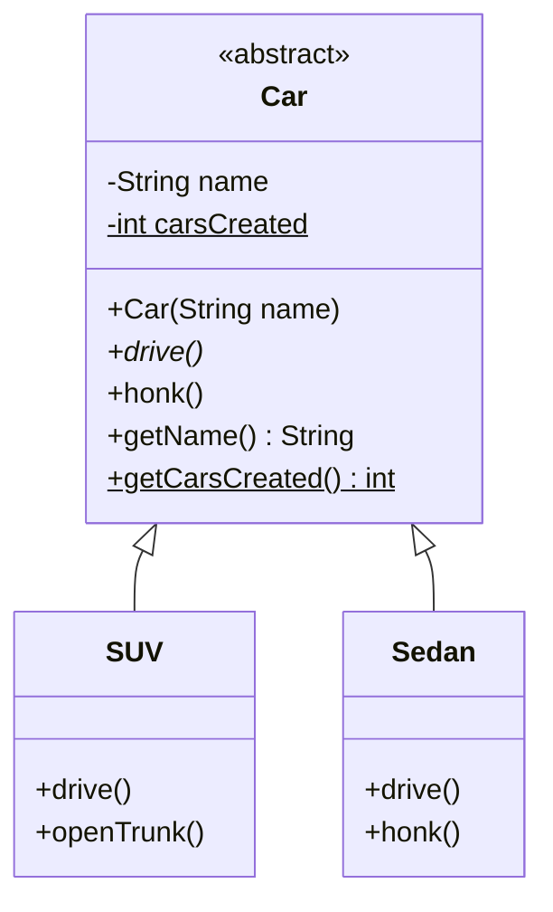

# Abstraction and Abstract Classes

## What is abstraction?

**Abstraction means hiding the details and showing only what matters**: _what_ an object can do, not _how_ it does it.

Example: you press the gas pedal to drive a car, without knowing how the engine works.

In code, a parent class says **what** must be done (the method names), and each child class decides **how** to do it.

### Types of abstraction in Java

1. **Abstract class** (this lesson)
2. **Interface** (next lesson)

---

## Abstract class

A class declared with the keyword **`abstract`**.

```java
public abstract class Car { ... }
```

- It **can't be instantiated** (you can't create an object from it with `new`).
- It **should be inherited**. Its job is to be a parent, so a child class completes it.
- It can have **abstract** and **non-abstract (concrete)** methods.
- It can also have: fields, a **constructor**, **final** methods, and **static** methods.

```java
Car car = new Car("Any");   // ERROR: Car is abstract; cannot be instantiated
```

> A constructor in an abstract class is not used with `new Car(...)`. It runs when a child object is created, through `super(...)`.

---

## Abstract method

A method declared with `abstract`, with **no body** (it ends with `;`).

```java
public abstract void drive();
```

- It can only be inside an abstract class.
- Every **concrete** child **must implement** it. If it doesn't, the child must be `abstract` too.

---

## Concrete class and concrete method

- **Concrete method:** a normal method **with a body** (a full implementation).
- **Concrete class:** a normal class, so you can create objects from it. If it extends an abstract class, it must implement **all** the abstract methods.

||Abstract|Concrete|
|---|---|---|
|Keyword|`abstract`|none|
|Method body|none (`;`)|has a body `{ ... }`|
|Create objects (`new`)|No|Yes|

---

## Rules in short

|Question|Answer|
|---|---|
|Which keyword?|`abstract`|
|Can it have concrete methods?|Yes|
|Can it have no abstract methods at all?|Yes (it is still abstract if declared so)|
|Can it have fields, a constructor, final and static methods?|Yes|
|Can I create an object with `new`?|**No**|
|Must it be inherited?|Yes, otherwise it is useless|
|A class with an abstract method|must be declared `abstract`|

---

## UML class diagram

How to tell abstract from concrete:

- The **abstract class** name is written in _italics_, or has the label `<<abstract>>`.
- An **abstract method** is written in _italics_.
- A concrete class or method is written normally.
- The arrow with an empty triangle means "inherits from".



(`*` = abstract method, `$` = static member.)

---

## Why can't `abstract` be used with `static`, `private` (or `final`)?

An abstract method **must be overridden by a child**. These modifiers make that impossible:

|Combination|Why it doesn't make sense|Compiler error|
|---|---|---|
|`abstract` + `static`|A static method belongs to the **class** and is called without an object (`Car.drive()`), so with no body there is nothing to run. Static methods also can't be overridden.|`illegal combination of modifiers: abstract and static`|
|`abstract` + `private`|A private method is **invisible** to the children, so they can't implement it.|`illegal combination of modifiers: abstract and private`|
|`abstract` + `final`|`final` means "can't be overridden", but `abstract` means "must be overridden".|`illegal combination of modifiers: abstract and final`|

Other errors you may see:

|Mistake|Compiler error|
|---|---|
|A concrete child doesn't implement an abstract method|`X is not abstract and does not override abstract method drive() in Car`|
|An abstract method with a body|`abstract methods cannot have a body`|

---

## Polymorphism with abstract classes

**Can I use polymorphism with abstract classes? Yes.** You can't create a `Car`, but a `Car` **reference** can point to any child object:

```java
Car c1 = new SUV("Jeep");
Car c2 = new Sedan("Toyota");

Car[] cars = {c1, c2};
for (Car c : cars) {
    c.drive();      // runs the CHILD's version
}
```

### A method that exists only in the child

The **reference type** (`Car`) decides which methods you are **allowed to call**. The **object type** (`SUV`) decides **which version runs**.

So the method you call through the parent reference must be declared in the parent (abstract or concrete), and shared with the children. A method that exists only in the child is a compile error:

```java
Car c1 = new SUV("Jeep");
c1.openTrunk();    // ERROR: cannot find symbol
```

To use it, check the real type and cast:

```java
if (c1 instanceof SUV) {
    ((SUV) c1).openTrunk();
}
```

---

## Can I declare an abstract class variable without assigning it?

**Yes.** The variable is only a **reference** (no object is created). But you must assign it before using it:

```java
Car c3;                  // OK: just a reference
c3.drive();              // ERROR: variable c3 might not have been initialized

c3 = new Sedan("Honda"); // assign a CHILD object
c3.drive();              // OK
```

`Car c = new Car("x");` is always an error, because the class is abstract.

---
## Summary

- **Abstraction:** hide the details, show what matters.
- **Abstract class:** can't be instantiated, must be inherited, can mix abstract and concrete members.
- **Abstract method:** no body, children must implement it.
- **No `abstract` with** `static`, `private` or `final`.
- **Polymorphism works:** a parent reference can hold a child object, but only the parent's methods can be called through it.
