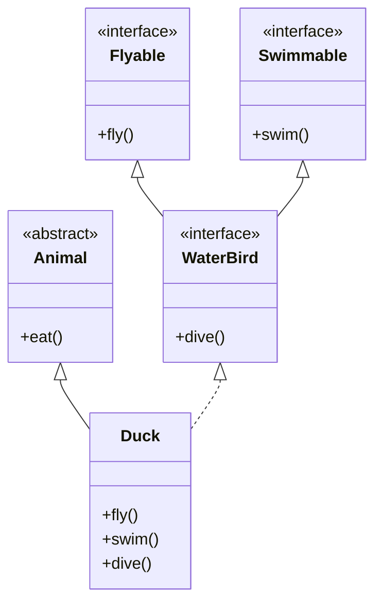

# Interfaces in Java

## What is an interface?

An interface is a **blueprint (a contract)** that says **what** a class must be able to do, without saying **how**. It provides **pure abstraction**.

> It has nothing to do with UI/UX. "Interface" here is a Java type, not a screen.

### How it changed over time

|Java version|What changed|
|---|---|
|**JDK 1.7 and before**|An interface was **100% abstract**: only method signatures and constants|
|**JDK 1.8 (2014)**|Can be **less than 100% abstract**: `default` methods and `static` methods **with a body**|
|**JDK 9**|**`private` methods** with a body (helpers for the default and static ones)|

---

## Interface rules

- A **class implements** an interface (`implements`), it doesn't extend it. A class can implement **one or more** interfaces.
- An **interface extends** other interfaces (`extends`), **one or more**.
- Interfaces are **the only way to get multiple inheritance** in Java (a class can extend only one class, but implement many interfaces).
- An interface has **no constructors**.
- Default modifiers (you don't have to write them):

|Member|Default|
|---|---|
|**Attributes**|`public static final` (they are constants, and must be given a value)|
|**Methods**|`public abstract`|

```java
interface Flyable {
    int MAX_HEIGHT = 1000;   // public static final
    void fly();              // public abstract
}
```

### What is not allowed

|Mistake|Compiler error|
|---|---|
|A class `extends` an interface|`no interface expected here`|
|An interface `extends` a class|`interface expected here`|
|An interface `implements` an interface|`'{' expected` (use `extends`)|
|A constructor in an interface|`<identifier> expected`|
|Changing an interface attribute|`cannot assign a value to static final variable X`|
|Implementing a method without `public`|`f() in T cannot implement f() in I` (attempting to assign weaker access privileges)|

**Remember:** `extends` for class → class and interface → interface. `implements` for class → interface.

---

## Who can implement an interface?

|Type|Can implement an interface?|
|---|---|
|Class (and nested class)|Yes. It must implement **all** the abstract methods.|
|Abstract class|Yes. It may implement only some of them and leave the rest abstract.|
|Enum|Yes (covered in the next lessons)|
|Record (Java 16+)|Yes|
|Interface|It doesn't _implement_, it **extends** one or more interfaces|

---

## UML

- An interface is drawn with the label `<<interface>>`.
- **Realization:** a class and the interface it implements are joined by a **dashed arrow with an empty triangle**.
- An interface that extends another interface, or a class that extends a class, uses a **solid arrow with an empty triangle** (inheritance).



> **Is-a relationship:** in UML, the link between two interfaces is _generalization_ (is-a), and the link between a class and its interface is _realization_. They are different arrows. In Java code the implementing class is still a **subtype**: `Flyable f = new Duck();` works, and `duck instanceof Flyable` is `true`.

---

## Abstract class vs interface

||Abstract class|Interface|
|---|---|---|
|Keyword|`abstract class`|`interface`|
|Used with|`extends` (only **one**)|`implements` (**many**)|
|UML|name in _italics_ or `<<abstract>>`, solid inheritance arrow|`<<interface>>`, dashed arrow to the implementer|
|Naming convention|a **noun**: `Vehicle`, `Animal`|a **capability**, often ending with _-able_: `Runnable`, `Comparable`, `Flyable`|
|Constructor|Yes|**No**|
|Attributes|any kind|only constants (`public static final`)|
|Methods|abstract and concrete, any access|abstract by default, plus `default`, `static` and `private` (Java 8 and 9)|
|Idea|"**is a** kind of": shares state and code between related classes|"**can do**": a capability any class can have|

---

## Java 8: default and static methods

### `default` methods

A `default` method has a **body** inside the interface, so adding it doesn't break the classes that already implement the interface.

```java
interface Greeter {
    String greet(String name);

    default String twice(String name) {
        return greet(name) + " " + greet(name);
    }
}
```

- A default method is always **`public`**. (`default` is just a keyword here, not an access modifier.)
- If the implementing class overrides it, the override must also be **`public`**.

### `static` methods

A `static` method can also have a body, but it belongs to the **interface itself**:

```java
interface MathTools {
    static int square(int x) { return x * x; }
}

MathTools.square(5);        // OK
// SomeClass.square(5);     // ERROR: cannot find symbol (static interface methods are not inherited)
```

### Same method name in the parent class and the interface

The case: an interface has `newMethod()`, a parent class has its own `newMethod()`, and a new class `extends` the parent and `implements` the interface.

```java
interface I { default void newMethod() { System.out.println("interface default"); } }
class Parent { public void newMethod() { System.out.println("parent class method"); } }
class Both extends Parent implements I { }

new Both().newMethod();   // prints: parent class method
```

- **There are not two methods in the new class.** There is one `newMethod()`, the one inherited from the parent.
- **The parent's method is called**, even through an interface reference (`I i = new Both(); i.newMethod();` also prints the parent's version).
- **Why:** the rule is **"the class always wins"**. A method inherited from a class beats a default method of an interface.
- **Why there is no error:** the inherited public method has the same signature, so it counts as the implementation (or override) of the interface method. There is nothing ambiguous for the compiler to complain about.
- **Condition:** the parent's method must be `public`. If it is `protected` or package-private, you get an error: `m() in P cannot implement m() in I` (weaker access privileges).

### Two interfaces with the same default method

If a class implements two interfaces that both have a default method with the same signature, there is **no winner**, and the compiler gives an error (`types A and B are incompatible; class C inherits unrelated defaults`). The class **must override** the method. It can call a specific interface version with `InterfaceName.super.method()`:

```java
class C implements A, B {
    public void h() {
        A.super.h();    // choose A's version
        B.super.h();    // and/or B's version
    }
}
```

---

## Java 9: private methods

An interface can have **`private`** (and `private static`) methods with a body. They are helpers for the `default` and `static` methods, so the code isn't repeated.

```java
interface Calc {
    default int total() { return helper(2) + helper(3); }
    private int helper(int x) { return x * 10; }   // hidden helper
}
```

A private interface method is invisible to the implementing classes (calling it from there gives `cannot find symbol`).

---

## Nested interfaces

An interface can be declared **inside a class or inside another interface**.

```java
interface Outer {
    interface Inner { void f(); }      // implicitly public and static
}

class T implements Outer.Inner { public void f() { } }
```

- Inside an **interface**, a nested interface is implicitly `public static`.
- Inside a **class**, it can have any access modifier. A `private` nested interface can't be used from outside (`P has private access in C`).
- You reach it with the outer name: `Outer.Inner`.

---

## Functional interface

An interface with **exactly one abstract method**. It can be used with a **lambda expression**. Examples: `Runnable`, `Comparator`.

```java
@FunctionalInterface
interface Greeter {
    String greet(String name);     // the only abstract method
}

Greeter g = name -> "Hello " + name;
```

- `@FunctionalInterface` is **optional**, but it makes the compiler check the rule. With two abstract methods you get `Unexpected @FunctionalInterface annotation`.
- A functional interface can still have `default` methods, `static` methods, and methods of `Object` (like `equals`).

---

## Marker (tagging) interface

An **empty interface** (no methods). It only **marks** a class, so other code can ask "does this class have the mark?", usually with `instanceof`.

|Marker|What it tells|
|---|---|
|`Serializable`|this object can be converted to bytes (saved or sent). `ObjectOutputStream` refuses classes without it.|
|`Cloneable`|`clone()` is allowed. Without it, `super.clone()` throws `CloneNotSupportedException`.|
|`RandomAccess`|the list gives fast access by index. Algorithms can check it to choose a faster method.|

```java
new ArrayList<Integer>() instanceof RandomAccess;   // true  (fast get(i))
new LinkedList<Integer>() instanceof RandomAccess;  // false (slow get(i))
```

---

## Generic interfaces

**Problem:** an interface method returns `Object` (or another parent type). With polymorphism, you must **cast** the result every time, and the compiler can't check it for you:

```java
interface RawBox { Object get(); }

RawBox b = new StringBox();
// String s = b.get();          // ERROR: Object cannot be converted to String
String s = (String) b.get();    // cast needed (and it can fail at run time)
```

**Solution:** make the interface **generic**, with a type parameter (`E` is the usual letter for an element type, `T` for a type). The type is chosen when you use it:

```java
interface Box<E> {
    E get();
}

class StringBox implements Box<String> {          // choose the type here
    public String get() { return "hello"; }
}

Box<String> b = new StringBox();
String s = b.get();               // no cast
// Integer i = b.get();           // ERROR at compile time: String cannot be converted to Integer
```

- The type goes **after the interface name**: `Box<String> b = new StringBox();`. (Not `Box b<String>`.)
- The implementing class has **two options**:
    1. **Fix the type:** `class StringBox implements Box<String>`. Its methods use that type.
    2. **Stay generic:** `class Holder<E> implements Box<E>`. The type is chosen when you create the object: `Box<Integer> b = new Holder<>();`.
- So not everything in the class has to be generic. Only the parts that use the type parameter change.
- **Benefit:** no casts, and wrong types are caught at **compile time** instead of run time.

---

## Why and when to use interfaces

|Reason|What it means|
|---|---|
|**Hiding the implementation (security)**|Other code sees only the methods in the interface, not the internal details of the class. (This is information hiding, not protection against attacks.)|
|**Multiple inheritance**|A class can implement many interfaces, so it can have many abilities.|
|**Multiple extends between interfaces**|One interface can combine several others (`WaterBird extends Flyable, Swimmable`).|
|**Loose coupling**|Code depends on the **interface**, not on a specific class, so you can replace the class without changing the code.|
|**Polymorphism**|One reference type works with many different classes.|
|**Easy testing and teamwork**|The contract is agreed first, then each person writes an implementation, or a test can use a fake one.|

Loose coupling in one line:

```java
List<String> names = new ArrayList<>();     // later: new LinkedList<>() with no other change
```

### Interface or abstract class?

- Use an **interface** when unrelated classes should share a **capability** (`Comparable`, `Runnable`), or when a class needs **several** such abilities.
- Use an **abstract class** when related classes should share **state, a constructor, or ready-made code**.

---

## Summary

- An interface is a **contract**: it says what to do, not how.
- Class → **`implements`** (many). Interface → **`extends`** (many). No constructors.
- Attributes are `public static final`, methods are `public abstract` by default.
- Java 8: `default` and `static` methods. Java 9: `private` methods.
- **The class always wins** over an interface default method; two conflicting defaults must be resolved by overriding.
- Special kinds: **functional** (one abstract method, lambdas), **marker** (empty, used with `instanceof`), **generic** (a type parameter, no casts), **nested** (declared inside another type).

